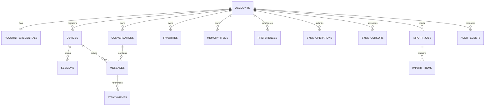

# Jarvis Account System — frozen data model

Статус: предложенная canonical model для будущей server/local-sync реализации. Текущая `backend/data/jarvis_state.sqlite3` не изменяется.

## 1. ID policy

Все новые canonical IDs — lowercase UUIDv7 strings без префикса. UUIDv7 дает глобальную уникальность и сортируемое по времени значение; сервер проверяет формат и ownership.

| ID | Формат | Правило |
|---|---|---|
| `account_id` | UUIDv7 | immutable personal-account owner; future memberships can reference it |
| `device_id` | UUIDv7 | один logical installation/client; reinstall создает новый device |
| `session_id` | UUIDv7 | одна authenticated session/device relationship |
| `conversation_id` | UUIDv7 | server canonical conversation identity |
| `message_id` | UUIDv7 | immutable canonical message identity |
| `attachment_id` | UUIDv7 | accepted object metadata identity |
| `memory_id` | UUIDv7 | one consented personal-memory item |
| `operation_id` | UUIDv7 | one client mutation attempt; unique per account |
| `import_id` | UUIDv7 | one immutable import job/manifest |
| `source_local_id` | opaque UTF-8 string | original local session/message ID, namespaced by `(device_id, import_id)` |
| `client_message_id` | UUIDv7 | stable client identity for message append; unique `(account_id, client_message_id)` |

Server may expose `server_sequence` (monotonic bigint) for ordered sync feed, but it is not an entity identity. Local SQLite rowid is never a cloud ordering or identity field.

### Import identity and deduplication

The import manifest maps each source record to `(import_id, device_id, source_local_id)`. Server stores a unique import-item key. Repeating the same `import_id` and manifest hash returns the prior job/result. A different import with the same source data does not silently merge unless the user confirms a displayed match; canonical message IDs remain distinct otherwise.

## 2. Canonical entities

| Entity | Required ownership | Key fields |
|---|---|---|
| `accounts` | root | `account_id`, status, display name, timestamps, deletion state |
| `account_credentials` | account | normalized unique email, Argon2id hash, verification/reset state |
| `devices` | account | `device_id`, platform, version, label, last_seen, revoked, optional future public key |
| `sessions` | device/account | refresh-token family hash, expiry, revoke/reuse state |
| `conversations` | account | `conversation_id`, title, archive state, timestamps, revision |
| `messages` | account + conversation | `message_id`, client ID, device, role, content, timestamps, sequence, revision |
| `attachments` | account + message | object key, detected MIME, size, SHA-256, status, deletion state |
| `favorites` | account + target | normalized one-row relation for favorite target |
| `memory_items` | account | consent state, source message/device, value, timestamps, revision |
| `preferences` | account/device scope | key/value, scope, revision, updated device |
| `sync_operations` | account + device | operation ID, entity, base revision, payload hash, result |
| `sync_cursors` | account + device | last server sequence and updated time |
| `import_jobs/items` | account + device | import ID, manifest hash, source ID, status, target ID |
| `audit_events` | account/security scope | action, actor device, timestamp, metadata without message body |

## 3. Favorites: one source of truth

Use normalized `favorites` as the only canonical source. Do not add `conversations.favorite` as a second mutable state. A conversation favorite is represented by one row:

```text
favorites(
  account_id,
  entity_type = 'conversation',
  entity_id = conversation_id,
  created_at,
  created_by_device_id,
  PRIMARY KEY(account_id, entity_type, entity_id)
)
```

The API may project `favorite: true` in a conversation DTO for UI convenience, but that field is derived. Message favorites or future entities use the same relation with explicit allowed entity types.

## 4. Relationship diagram



## 5. Entity rules

### Conversations and messages

`conversations` has `account_id`, `created_by_device_id`, `created_at`, `updated_at`, `last_message_at`, `title`, `archived_at`/archive state, `revision`, `deleted_at`. `messages` has `account_id`, `conversation_id`, `message_id`, `client_message_id`, `device_id`, `role`, content, `created_at_client`, `created_at_server`, `server_sequence`, `reply_to_message_id`, `revision`, `deleted_at`, and non-secret execution metadata. Message append is immutable except explicit redaction/delete tombstone.

### Attachments

`attachments` stores no local path. It stores `attachment_id`, owner IDs, opaque `object_key`, original display name, detected MIME, size, SHA-256, scan status, created/deleted timestamps and retention state. Accepted only after MIME, size, checksum and scan checks. Per-file and per-account quotas are configurable; initial proposed defaults are 25 MiB/file and 1 GiB/account, pending approval.

### Memory

`memory_items` includes `memory_id`, account, value, kind, `source_message_id`, `source_device_id`, source date, confidence/provenance, consent state, revision and deletion state. Import is previewed and user-confirmed. No rule converts every message into memory. Knowledge Library is a separate versioned application dataset and is not a child of account.

### Preferences

Only allowlisted preferences sync. Each preference has explicit scope: `account`, `device`, or `local_only`. Provider keys, absolute paths, local model paths, microphone selection and system capabilities are device/local-only. AI routing policy and memory-sync consent are account-synced settings with device override only where explicitly defined.

## 6. Sync ledger

`sync_operations` records `operation_id`, account, device, entity type/id, operation type, payload hash, `base_revision`, created time, status, result revision and serialized result/error. Unique `(account_id, operation_id)` makes retry safe; same ID with a different payload hash is rejected as misuse.

`sync_cursors` records per-device last applied `server_sequence`. Pull returns ordered changes plus tombstones. Cursor advances only after local transaction applies the complete page.

## 7. Deletion model

All synced entities support tombstone. Message deletion removes it from normal reads and propagates a redacted/deleted marker; conversation deletion tombstones conversation, messages, favorite relation and attachment references. Attachment object deletion is asynchronous. Account deletion first exports if requested, revokes sessions/devices, tombstones account data and schedules purge after approved retention. Backup copies follow a separate expiry policy.

## 8. Mapping from current Jarvis

Current `chat_sessions.id` and `chat_messages.id` become source IDs during import, not canonical cloud IDs. `chat_id` maps to source conversation. `facts.json` items map to memory only after separate preview/consent. QSettings profile maps to account profile/preferences only after confirmation. Current schema receives no columns and no migration in Phase 0/0.5.
