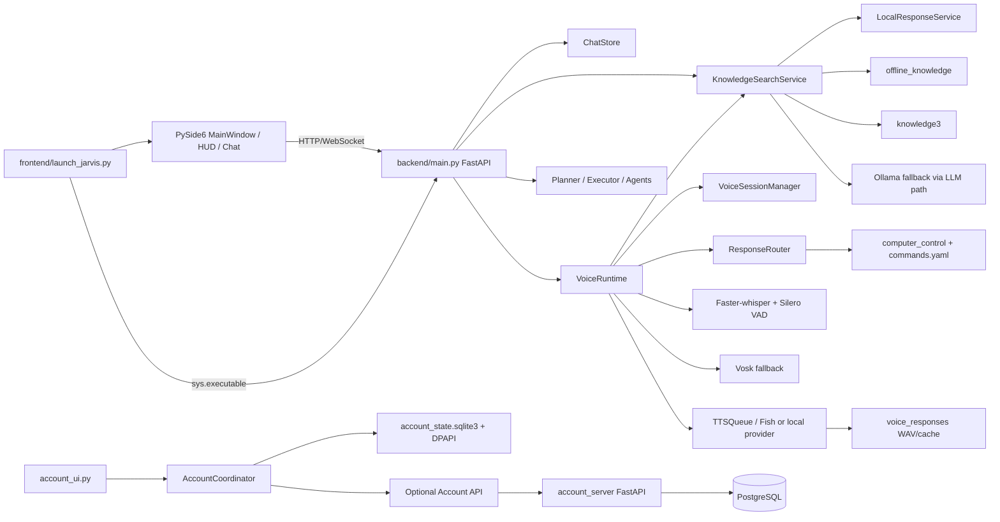
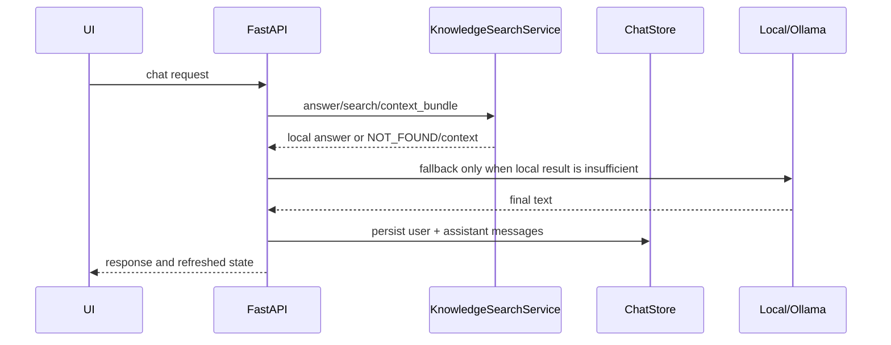
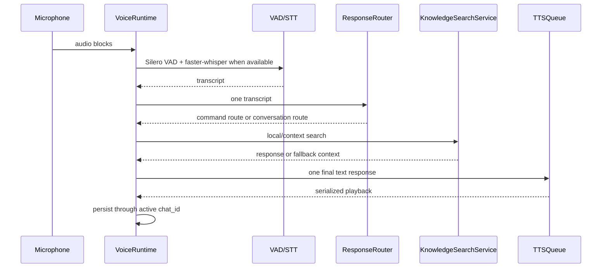

# Jarvis — Architecture Audit

Status: CURRENT  
Last Updated: 2026-11-15  
Replaces: none

Дата: 2026-11-15  
Режим: аудит текущего дерева и подтверждённого кода; опасные операции, миграции и удаление данных не выполнялись.

## 1. Краткий вывод

Jarvis уже имеет один основной локальный FastAPI application в `backend/main.py`, один штатный launcher `frontend/launch_jarvis.py` и один основной runtime голосового режима `backend/services/voice_runtime.py`. При этом внутри процесса были два экземпляра логического knowledge/voice-response фасада: `main.py` создавал сервисы для API, а `VoiceRuntime` создавал собственные экземпляры. Это устранено безопасным dependency injection: runtime теперь получает общий `KnowledgeSearchService` из composition root, сохраняя fallback для прямого тестового создания.

Остальные «дубли» имеют разную природу и не должны удаляться механически:

- Vosk — fallback в основном VoiceRuntime и отдельный push-to-talk путь диктовки UI.
- Silero VAD + faster-whisper — предпочтительный live voice путь при доступности пакетов.
- `account_state.sqlite3` и `jarvis_state.sqlite3` — разные bounded contexts, а не две копии одной таблицы.
- PostgreSQL Account Server — отдельный cloud/auth boundary, не второй локальный Jarvis backend.
- `offline_knowledge`, `knowledge3`, `voice_responses` — физические источники под одной логической search facade; физическое объединение пока не доказано безопасным.

## 2. Подтверждённое дерево

```text
C:\projects\Jarvis
├─ frontend/
│  ├─ launch_jarvis.py             штатный launcher/backend child process
│  ├─ jarvis_ui.py                 главное PySide6 окно, HUD, chat/navigation
│  ├─ chat_composer.py             composer и push-to-talk helper
│  ├─ voice_input.py               отдельный Vosk dictation adapter
│  └─ account_ui.py                account dialogs и Google login action
├─ backend/
│  ├─ main.py                      основной FastAPI composition root/API
│  ├─ services/
│  │  ├─ voice_runtime.py          микрофон, VAD/STT, command/conversation route
│  │  ├─ knowledge_search_service.py logical knowledge search facade
│  │  ├─ knowledge_index_service.py integrity/catalog status
│  │  ├─ local_response_service.py local text/WAV response matching
│  │  ├─ chat_store.py              chat SQLite repository
│  │  ├─ voice_session_manager.py  active voice session ownership
│  │  └─ action_executor.py        controlled Windows action boundary
│  ├─ voice_engine/
│  │  ├─ stt.py                     faster-whisper adapter
│  │  ├─ vad.py                     Silero VAD adapter
│  │  ├─ tts.py / tts_queue.py      TTS selection and serialized playback
│  │  ├─ model_small/               Vosk fallback model
│  │  └─ wakeword_engine.py         legacy/independent wakeword module
│  ├─ account/                      local account/domain/sync client boundary
│  ├─ account_server/               optional cloud auth API/PostgreSQL service
│  ├─ agents/                       planner, executor, web/file/etc. agents
│  └─ data/
│     ├─ jarvis_state.sqlite3       local chat/application state
│     ├─ jarvis.sqlite3             legacy/other local database; usage needs migration audit
│     └─ account_system/account_state.sqlite3 local account/device/session metadata
├─ data/
│  ├─ voice_responses/              local response catalog and WAV references
│  ├─ offline_knowledge/            reviewed/offline knowledge source
│  ├─ knowledge3/                   structured knowledge source/index
│  └─ filesystem_index.db           filesystem index/cache
└─ docs/                            audit, handoff, account, voice and knowledge decisions
```

Dependency environments (`backend/jarvis_env`, `backend/device_env`) and their site-packages are excluded from the functional tree. They are runtime/dependency payloads, not application components.

## 3. Current connection map



## 4. Message and voice paths

### Text message



### Voice message



## 5. STT/VAD decision table

| Component | Current use | Evidence | Decision |
|---|---|---|---|
| faster-whisper | Preferred live STT when available | `voice_runtime.py` imports `FasterWhisperRecognizer` and checks `.available()` | Keep as primary candidate; verify model/runtime separately |
| Silero VAD | Preferred segmentation with faster-whisper | `voice_runtime.py` and `voice_engine/vad.py` | Keep as selected VAD path |
| Vosk | Fallback in `VoiceRuntime`; separate UI dictation adapter | `voice_runtime.py`, `frontend/jarvis_ui.py`, `frontend/voice_input.py` | Keep temporarily; unify behind one STT contract before removal |
| `wakeword_engine.py` | Imports Silero and owns an independent stream/wakeword loop | no active import from `main.py`/`VoiceRuntime` found | Mark legacy/unverified; do not delete until runtime/import scan and owner decision |
| command parser | Registered command route | `ResponseRouter` → `computer_control.find_intent` | Keep as explicit route before conversation; not a competing free-form LLM route |
| ConversationResolver | Deterministic conversational answers used by knowledge facade | `KnowledgeSearchService` | Keep and extend only through the existing facade; do not add a second orchestrator now |

The current source supports a layered route, not simultaneous answer generation: command route first, otherwise conversation/knowledge route. A remaining risk is that an acknowledgement local match and command-specific WAV can both be eligible in one command path; this needs a focused runtime test before changing behavior.

## 6. Backend and account boundaries

`backend/main.py` is the normal local product backend. `backend/account_server/app.py` is a separately constructible FastAPI application with PostgreSQL-only configuration, SMTP and Google identity validation. It is not imported into the normal `main.py` composition root. This separation is currently technically justified by the cloud/auth deployment boundary, but the client talks to it through `HttpAuthProvider` only when `JARVIS_ACCOUNT_API_URL` is configured.

The UI account flow is real code, not proof of successful OAuth: `AccountLoginDialog` starts `AccountCoordinator.login_with_google()`, which uses loopback OAuth and then `HttpAuthProvider`; without configured provider/client credentials it returns an explicit unavailable/not-configured result and preserves Local Mode.

## 7. Storage inventory

| Store | Current owner/use | Decision |
|---|---|---|
| `backend/data/jarvis_state.sqlite3` | Chat/application state through `STATE_DB_PATH` and `ChatStore` | Keep as local canonical state until repository migration plan |
| `backend/data/account_system/account_state.sqlite3` | Account identity, device, session/sync metadata; no chat history | Keep separate local account boundary; unify contracts, not files |
| Account PostgreSQL | Cloud account/auth/server state | Keep as cloud adapter; migration requires isolated DB plan |
| `data/filesystem_index.db` | Filesystem indexing/cache | Keep while consumers remain; classify as technical index |
| `backend/data/jarvis.sqlite3` | Existing additional local DB | Usage and entity overlap require targeted audit before any decision |
| `offline_knowledge`, `knowledge3`, `voice_responses` | Physical knowledge/audio roots | Keep; expose through one logical catalog/search contract |

No database migration, deletion, or data rewrite was performed in this audit.

## 8. Confirmed change in this pass

`VoiceRuntime` now accepts the already-created `KnowledgeSearchService` from `backend/main.py`. Direct construction still creates its fallback for isolated tests. This removes the normal-process duplicate service graph without changing storage paths, response precedence, API routes, WAV files, or user data.

Verification: targeted `py_compile` passed; backend unittest discovery passed `56/56` with `-W error::ResourceWarning`.

## 9. Open risks / not yet proven

- Human speech through the full faster-whisper inference path and audible TTS playback require live-device acceptance; prior reports did not prove both end to end.
- The Windows listener on port 8000 has historically been an older process; no existing process was stopped.
- `jarvis.sqlite3` overlap with `jarvis_state.sqlite3` is not yet mapped entity-by-entity.
- Account Server integration into the main FastAPI process is not automatically safe; it needs deployment, auth, PostgreSQL lifecycle and failure-isolation decisions.
- Physical Bible consolidation is not approved; current safe target is a logical canonical catalog/adapters layer.
- `wakeword_engine.py` and UI Vosk dictation need a dedicated deprecation/contract decision, not name-based deletion.
