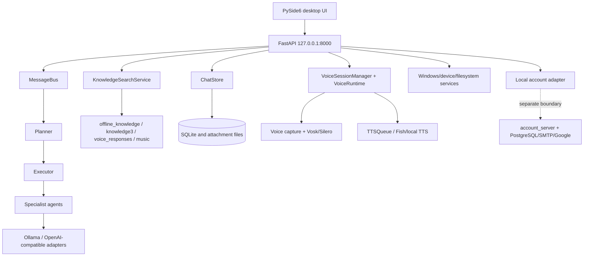

# JARVIS full system audit

Audit date: 2026-11-15  
Directory: `C:\projects\Jarvis`  
Mode: read-only investigation. No source/data/config correction was performed.

## Executive conclusion

Jarvis is a Windows PySide6 desktop client backed by a local FastAPI application. Its current canonical path is:

`PySide6 UI → loopback FastAPI → local knowledge resolver OR Planner/agents → provider/tools → ChatStore/runtime events → UI`.

Voice is a parallel runtime bound to the same `ChatStore` when a widget or chat voice session has a `chat_id`. Knowledge has a unifying read facade but remains physically distributed across three main libraries plus music/index/state files. Account functionality has both a local adapter and a separate PostgreSQL/SMTP/Google server boundary; their default production integration is not proven.

The strongest evidence is static source inspection, import smoke, existing handoffs and a fresh 47/47 unittest run. The largest evidence gap is current runtime UI/audio behavior: no Jarvis instance was running, and the frozen EXE was older than the dirty source tree, so it was not launched as a proxy.

## State and verification

- Git branch: `master`; ahead of origin by 21 commits.
- Working tree dirty before audit, including substantial uncommitted backend/frontend/data/docs changes.
- `backend.main` import smoke: PASS; startup check reports Python, Node, npm, Git, ffmpeg and Ollama executables present.
- `unittest`: 47/47 PASS.
- `pytest`: unavailable (`No module named pytest`).
- Test run emitted repeated SQLite `ResourceWarning: unclosed database` messages.
- No migrations, dependency installation, service restart, mass audio generation, reset/checkout, delete or data rewrite was performed.

## Architecture

## Main scenario findings

### Text chat

`POST /chat` stores the user message, caches attachments off the event loop, builds a bounded prior context, asks `KnowledgeSearchService` for an early local answer, and otherwise sends a plan request through `MessageBus`. The assistant result is stored in `ChatStore` and runtime events are emitted for UI polling. This path is structurally implemented and covered by component tests, but no live request was made in this audit.

### Chat/session management

The backend provides create/list/rename/pin/archive/delete sessions, history, messages, reactions, pins and media routes. The frontend has callbacks for these routes. Unit coverage confirms bounded chronological history and message normalization; cross-chat UI isolation and restart restoration remain manual gates.

### Voice

The voice path is `microphone → VoiceRuntime → Vosk/Silero/fallback → local knowledge or conversation → TTSQueue → playback`. `VoiceSessionManager` enforces one active widget/chat session and binds chat voice to a selected chat. Voice text is persisted into ChatStore when chat-bound. The code and existing handoff support this design; physical microphone capture, audio playback and device-release behavior were not re-run.

### Knowledge

`KnowledgeSearchService` searches conversational intents first, then reviewed offline topics, programming/music and Knowledge 3.0 domains. It can return a local answer before Planner/LLM. It builds canonical IDs at read time and retains source locations/legacy IDs. This reduces duplicate runtime logic but does not remove physical catalog duplication.

### AI/providers

Supported provider code includes Ollama and multiple OpenAI-compatible profiles through adapters, with retry/error mapping and streamed Ollama deltas. Provider configuration is persisted through the config service. Exact requests per user message are not instrumented; voice start includes an Ollama warmup request when the active provider is Ollama, so cost accounting must distinguish warmup from user turns.

### Windows/external integrations

Filesystem, application, browser and device routes exist. Some actions call `subprocess` or `os.system` directly, including shutdown/reboot in `computer_control.py`. The current handoff says browser automation, Figma OAuth and plugins are not complete integrations. They must not be reported as working merely because a menu item or route exists.

## Storage and resource profile

Approximate scanned sizes:

| Area | Size |
|---|---:|
| `backend/jarvis_env` | 4.78 GB |
| `backend/device_env` | 1.18 GB |
| `data/offline_knowledge` | 1.77 GB |
| `data/voice_responses` | 332 MB |
| `data/knowledge3` | 96.5 MB |
| `external` | 19.16 GB |
| `dist` | 2.96 GB |
| `models` | 116 MB |

These figures include local/generated assets and are not RAM/CPU measurements. Live RAM/CPU/GPU consumption and concurrent process count were not measured because no Jarvis runtime was active.

## Highest-priority findings

1. Wildcard CORS on a control-capable local API.
2. No fresh current-source UI/audio acceptance evidence.
3. Monolithic `backend/main.py` and `frontend/jarvis_ui.py` create broad regression surfaces.
4. Distributed knowledge and voice storage ownership.
5. Direct Windows control calls without one demonstrated confirmation/audit boundary.
6. SQLite resource warnings in the test/knowledge path.
7. Account server/local account integration boundary is incomplete as evidence.

Detailed registry: [JARVIS_BUG_REGISTRY.md](../../runtime/bug_registry/JARVIS_BUG_REGISTRY.md).  
Detailed plan: [JARVIS_OPTIMIZATION_PLAN.md](../migration/JARVIS_OPTIMIZATION_PLAN.md).

## Completion assessment

The repository can now be described with a reliable static architecture map, call map, storage inventory and prioritized risk register. It cannot yet be called a complete runtime acceptance audit because current-source UI screenshots, real microphone/TTS behavior, frozen current build behavior, reboot autostart and live account/PostgreSQL boundaries remain unverified.

Supporting documents:

- [JARVIS_PROJECT_TREE.md](../dependency_maps/JARVIS_PROJECT_TREE.md)
- [JARVIS_DEPENDENCY_MAP.md](../dependency_maps/JARVIS_DEPENDENCY_MAP.md)
- [JARVIS_UI_UX_AUDIT.md](../../ui/audits/JARVIS_UI_UX_AUDIT.md)
- [JARVIS_BUG_REGISTRY.md](../../runtime/bug_registry/JARVIS_BUG_REGISTRY.md)
- [JARVIS_OPTIMIZATION_PLAN.md](../migration/JARVIS_OPTIMIZATION_PLAN.md)
