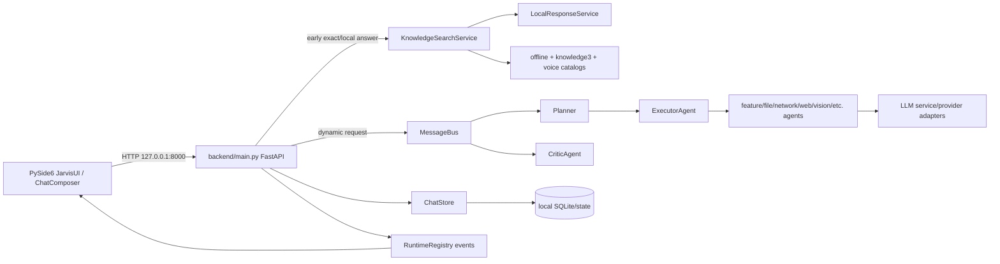
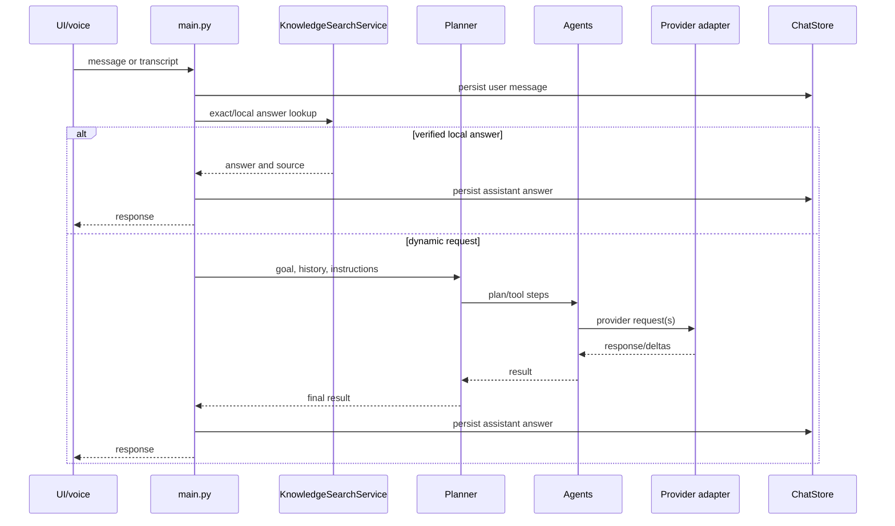
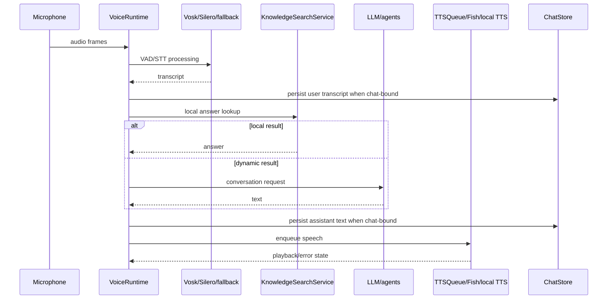

# Jarvis — dependency and call map

Audit date: 2026-11-15. Evidence was taken from imports, route declarations, callback code, service construction and the existing test suite. A file's presence is not treated as proof that its feature works.

## Canonical runtime path

## Component contracts

| Component | Entry/caller | Calls | Inputs | Outputs/state | Status |
|---|---|---|---|---|---|
| `frontend/launch_jarvis.py` | user/autostart | backend process, health URL, UI process | local config and lock | processes, lock and launcher log | source path exists; actual launch not performed in this audit |
| `frontend/jarvis_ui.py` | Qt event loop | REST endpoints, media URLs, local Windows processes | user events, QSettings | widgets, settings, local UI state | statically connected; live behavior not verified |
| `backend/main.py` | Uvicorn/import | all agents/services and route handlers | HTTP/WebSocket models | responses, tasks, runtime events | import smoke passed |
| `ChatStore` | `/chat`, session/message routes, voice runtime | SQLite/file attachments | chat/session/message payloads | sessions, messages, reactions, pins, attachments | unit coverage passed; live restart persistence not observed |
| `KnowledgeSearchService` | `/knowledge/*`, `/chat`, `VoiceRuntime` | multiple JSON catalogs and local response matcher | query, limit | ranked result/context/answer; variant state may be persisted | unit coverage passed; physical audio not verified |
| `Planner`/`ExecutorAgent` | dynamic `/chat` path | MessageBus, tools and LLM-backed agents | goal, history, instructions | final result via pending future | unit contract present; end-to-end runtime not observed |
| `LocalLLMService` and adapters | planner/voice/tools/settings | Ollama or OpenAI-compatible HTTP providers | messages/config | text or streamed deltas | adapter tests passed; provider availability not proven |
| `VoiceRuntime` | `/voice/start`, `/voice/stop`, voice session routes | Vosk/Silero/fallback, local resolver, TTSQueue, ChatStore | microphone audio and session state | transcript, response, playback queue, chat messages | code/tests support behavior; microphone/speaker not runtime-verified |
| `VoiceSessionManager` | voice routes and runtime | no external store | source/chat_id/replace | one active session | unit/handoff evidence; live mutual exclusion not re-tested |
| `account/` | frontend account coordinator | local persistent store or auth provider | credentials/account actions | local account state/tokens | local tests pass; production account server link not proven |
| `account_server/` | separate app factory | PostgreSQL, SMTP, Google verifier | auth/account API requests | account/session rows and tokens | PostgreSQL tests skipped without isolated DB |
| `DawControlService` | knowledge/DAW API routes | discovery/subprocess | project/action/confirmed | plans or guarded process launch | route exists; no DAW execution verified |

## UI → backend mapping

| UI action | Endpoint(s) | Backend consumer | Evidence |
|---|---|---|---|
| send chat | `POST /chat`, runtime event polling | ChatStore → knowledge or planner/agents | `jarvis_ui.py`, `main.py` |
| list/create/rename/pin/archive/delete chats | `/chat/sessions*` | ChatStore | route and callback imports |
| history/messages/reactions/pins/media | `/chat/history`, `/api/messages*`, `/api/media/*` | ChatStore | route and callback imports |
| dictation microphone | local Vosk worker in `frontend/voice_input.py` | composer text insertion | frontend-only path |
| voice widget | `/voice/start`, `/voice/status`, `/voice/stop` | VoiceSessionManager + VoiceRuntime | frontend callbacks and routes |
| voice chat | `/voice/session/start`, `/voice/status`, `/voice/session/stop` | VoiceRuntime bound to chat | frontend callbacks and routes |
| LLM settings | `/settings/llm*` | config service/provider adapters | settings page code |
| hardware/camera | `/hardware/settings`, `/devices/*` | device capabilities | settings/device code |
| knowledge panels | mostly no direct UI path found | knowledge API services | backend routes; frontend coverage is incomplete |
| account dialogs | account coordinator/provider | local account boundary | account UI code; server reachability not proven |

## AI request flow

## Voice flow

## Known architectural boundaries

- `backend/main.py` is both composition root and route registry. This makes route/service ownership clear enough to trace but increases change coupling and import/startup risk.
- `KnowledgeSearchService` is the current unifying read facade; source files and generated audio remain owned by their original catalogs.
- The account server is a second application boundary, not a proven dependency of the default desktop launcher.
- Windows control is not a pure service abstraction: `computer_control.py`, UI callbacks and selected services call `subprocess`/`os.system` directly or via guarded adapters.
- The desktop client uses one configurable `API_ROOT` (`JARVIS_API_BASE_URL`), but direct `requests` calls and timeout/error handling remain spread across `jarvis_ui.py`; there is no shared typed client. Chat model, session lists, chat history, weather, backup status/run and device capability/camera Settings paths use the shared `NetworkOperationWorker`/`NetworkOperationBridge` Qt path. High-frequency voice-status polling uses `VoiceStatusClient` with QtNetwork and one in-flight GET/POST. These paths have isolated tests (2026-11-17); live UI retest and other direct GUI-thread calls remain open.
- Settings layout (2026-11-17): `JarvisUI.build_ui()` owns one `settings_scroll`
  and `CurrentPageStack`. The stack computes `sizeHint`, `minimumSizeHint` and
  `heightForWidth` for the visible page so a hidden AI page cannot force a
  scrollbar on Notifications/IRON. The root `JarvisUI.apply_styles()` owns the
  common dark `settingsCard`/Glass tile/provider panel theme. The left Sidebar
  Recent Chats list uses available layout height in normal and fullscreen;
  top-level resize no longer invokes queued fixed-size constraints. This is
  one UI shell and does not introduce another Settings window or backend.
