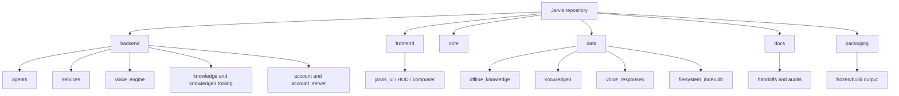

# Jarvis — project tree and inventory

Audit date: 2026-11-15  
Scope: `C:\projects\Jarvis`  
Mode: read-only investigation; this file is an audit artifact.

## Repository state

- Branch: `master`.
- Relation to `origin/master`: ahead by 21 commits.
- Working tree: dirty before the audit. Existing modified and untracked files were treated as user-owned and were not reset, checked out, deleted, or reformatted.
- The audit documents are the only intended additions from this task. No migrations, dependency changes, service restarts, or data cleanup were performed.

## Top-level map

| Path | Role | Audit status |
|---|---|---|
| `backend/` | FastAPI application, agents, services, voice engine, account code, local data adapters | Active source; monolithic entry point plus several parallel subsystems |
| `frontend/` | PySide6 desktop client, HUD, chat composer, account dialogs, local voice dictation | Active source; runtime behavior not re-tested in this audit because no instance was running |
| `core/` | Message bus and shared contracts | Active dependency of backend |
| `data/` | Knowledge catalogs, SQLite index, generated audio and state | Runtime data; multiple physical knowledge owners remain |
| `docs/` | Handoffs, specifications, audits, reports and historical journals | Large, partially overlapping documentation set |
| `packaging/` | PyInstaller and Inno Setup build scripts/assets | Release tooling |
| `build/`, `dist/` | Generated build output and frozen application artifacts | Generated; `dist/Jarvis-Assistant-Setup.exe` is about 478 MB |
| `backend/jarvis_env/` | Python environment/cache | 89,092 files, about 4.78 GB |
| `backend/device_env/` | Device/voice environment | 33,638 files, about 1.18 GB |
| `external/` | External repositories, model/tool sources and generated artifacts | About 19.16 GB; should not be treated as application source |
| `models/` | Local model assets | About 116 MB in the scanned tree |
| `logs/` | Runtime logs | Small at audit time; generated state |
| `backups/`, `workspace/`, `tools/` | Backup, scratch and support material | Requires explicit ownership policy before release packaging |

## Backend

### Entry points

- `backend/main.py`: canonical FastAPI app on `127.0.0.1:8000`; constructs agents, stores, voice runtime, knowledge services and routes.
- `backend/startup_check.py`: checks local executables and probes Ollama.
- `backend/health.py`: health and disk/system reporting.
- `frontend/launch_jarvis.py`: starts/health-checks backend and then the desktop client; uses a user lock to prevent a second source launch.
- `backend/account_server/main.py` and `backend/account_server/app.py`: separate account API/application factory; its isolated PostgreSQL flows are not part of the default `backend/main.py` startup path.

### Main backend packages

- `backend/agents/`: `MainAgent`, `Planner`, `ExecutorAgent`, `CriticAgent`, plus file/network/web/vision/voice/memory/backup/performance/game/social/policy/self-check agents.
- `backend/core/`: agent base, contracts, modes and message bus.
- `backend/services/`: chat persistence, runtime events, LLM/provider adapters, response routing, filesystem/application control, device capabilities, knowledge search/index, offline knowledge, programming/coding, music/audio/DAW/mixing, and voice session/runtime services.
- `backend/voice_engine/`: command catalog, STT/VAD/TTS adapters, model registry, TTS queue, generated voice-library tooling and legacy sound assets.
- `backend/account/`: local account domain, ports, persistent adapter, DPAPI credential storage and auth client/coordinator contracts.
- `backend/account_server/`: separate server-side account implementation with SQLAlchemy/Alembic, email delivery and Google identity validation.
- `backend/knowledge/` and `backend/knowledge3/`: catalog builders, indexers, validation and audio/material generation scripts. They are tooling and data-pipeline code, not one single runtime library.
- `backend/tests/`: unittest-compatible unit/contract coverage; PostgreSQL and live account API tests are environment-gated.

## Frontend

- `frontend/jarvis_ui.py`: large PySide6 main window; owns HUD controls, settings, chat/session actions, voice widget/chat voice, weather, backup/device pages and API calls.
- `frontend/jarvis_hud.py`: transparent HUD/metric layers and visual geometry.
- `frontend/chat_composer.py`: message input, attachment menu, dictation and voice-chat actions.
- `frontend/voice_input.py`: bounded local Vosk push-to-record dictation helper.
- `frontend/account_ui.py`, `frontend/profile_dialog.py`: account/profile dialogs; account UI has explicit unavailable-provider behavior in the current source.
- `frontend/autostart.py`: current-user Windows Run key integration.
- `frontend/assets/`: HUD/background/icons, video/chat assets, stickers, profile images and imported legacy artwork. This is a substantial asset tree and should not be confused with source modules.

## Data and generated material

- `data/offline_knowledge/`: offline topic catalog and research/variant/audio state; about 1.77 GB.
- `data/knowledge3/`: multi-domain structured catalog, indexes, project smoke data and knowledge state; about 96.5 MB.
- `data/voice_responses/`: conversational intents, manifest, variants and WAV responses; about 332 MB.
- `data/filesystem_index.db`: local filesystem index, about 3.17 MB.
- `backend/uploads/`: user-upload cache; about 178 MB at audit time.
- `.pth`, model directories, WAV, build output and external repositories are generated or environment assets, not portable source code.

## Duplicates and stale/unclear areas

1. Knowledge is physically distributed across `offline_knowledge`, `knowledge3`, `voice_responses`, local music indexes and research drafts. `KnowledgeSearchService` provides a read-only aggregation layer, but the source-of-truth ownership remains distributed.
2. Voice has a current `VoiceRuntime` plus legacy command/WAV conventions and separate generation scripts. The runtime is current; historical scripts and reports remain relevant only as evidence.
3. `build/` and `dist/` contain generated artifacts that can be older than current source changes. The frozen EXE was not used as proof of current source behavior.
4. `backend/jarvis_env`, `backend/device_env`, `external`, logs, uploads and caches are local operational state and should be excluded from primary architecture diagrams.

## Tree diagram

