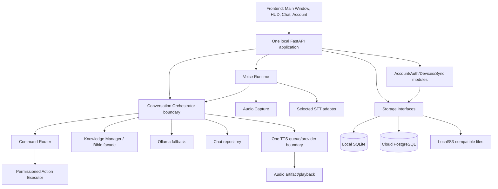
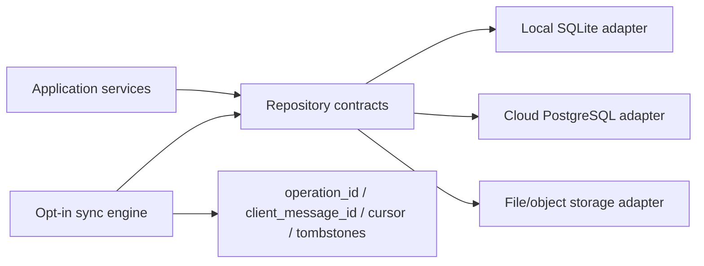

# Jarvis — Target Architecture

Status: CURRENT  
Last Updated: 2026-11-15  
Replaces: none

Статус: целевая схема после аудита; это не утверждение, что все слои уже реализованы.

## Principles

1. Один локальный application backend и один голосовой владелец на runtime.
2. Команда, knowledge lookup и свободный разговор — последовательные маршруты одного запроса.
3. `KnowledgeSearchService` — единая логическая точка поиска; Bible сначала является контрактом/каталогом, а не немедленным переносом файлов.
4. Local SQLite и Cloud PostgreSQL — адаптеры одной модели данных, не одна физическая база.
5. Account/Google OAuth остаётся opt-in и не ломает Local Mode.
6. Любая очистка выполняется после import/runtime evidence и обратимого плана.



## Recommended module ownership

| Boundary | Owns | Must not own |
|---|---|---|
| UI | view state, callbacks, display errors | direct SQLite, provider selection, Windows execution |
| API routers | transport validation and response mapping | duplicated business logic |
| Conversation boundary | one request lifecycle and source precedence | a second independent answer generator |
| Command Router | registered intent detection and policy handoff | arbitrary shell execution |
| Knowledge Manager | canonical IDs, sources, statuses, search adapters | direct UI state or TTS decisions |
| Voice Runtime | session, capture, STT, transcript handoff | independent chat history implementation |
| TTS queue | one serialized playback lifecycle | answer content selection |
| Storage interfaces | repository contracts and transactions | provider/business routing |
| Account | identity/device/session/sync opt-in | mandatory cloud dependency for Local Mode |

## Bible target

```text
Bible (logical root)
├─ canonical catalog / IDs / revisions
├─ source adapters
│  ├─ offline_knowledge
│  ├─ knowledge3
│  └─ voice_responses
├─ unified search/index contract
├─ material status and validation
├─ response variants and WAV references
└─ import/deduplication reports
```

The first implementation should be an adapter/catalog layer over existing roots. Physical movement is a later migration only after duplicate detection, link validation, backup and rollback are proven.

## Local + cloud



Canonical IDs, ownership, revisions, idempotency and tombstones are preserved. Login must not delete local data or silently enable Memory Sync.
