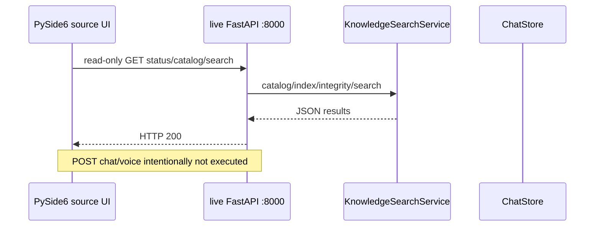

# JARVIS — Phase 2 runtime acceptance and root-cause report

Дата проверки: 2026-11-15  
Рабочая директория: `C:\projects\Jarvis`  
Режим: диагностика без исправления кода, конфигурации и пользовательских данных.

## 1. Граница проверки

Проверены исходный backend, живой listener `127.0.0.1:8000`, source PySide6 UI, accessibility tree, Ollama, read-only API и локальные аудиоустройства.

Не выполнялись:

- `POST /chat` и создание новых чатов;
- `/voice/start`, запись с микрофона и TTS-воспроизведение;
- изменение настроек, LLM-профиля или QSettings;
- миграции, массовые операции с WAV/knowledge и внешние платные TTS/API-запросы;
- запуск второго backend поверх занятого порта;
- остановка чужих процессов.

Причина ограничений: пользователь запретил менять данные/конфигурацию, а voice/chat сценарии в текущей реализации записывают сообщения или создают session state.

## 2. Git и процессы до запуска

- HEAD: `c94ce87594ccb976c75e55212ecf54ef936b3096`.
- Ветка: `master`.
- Состояние: `ahead 21`, рабочее дерево dirty; список существующих modified/untracked файлов сохранён без изменений.
- Listener `127.0.0.1:8000`: PID `10580`, `C:\Users\Данил\AppData\Local\Programs\Python\Python311\python.exe backend\main.py`.
- Родительский процесс: PID `4416`, `C:\projects\Jarvis\backend\jarvis_env\Scripts\python.exe backend\main.py`.
- PID `4416` и PID `10580` существовали до запуска UI и не останавливались.
- Ollama: порт `11434`, живой listener.
- PostgreSQL account listener: `127.0.0.1:5433` (Docker), но account end-to-end не запускался.

## 3. Точки входа и результат запуска

### 3.1 Backend

Команда, зафиксированная по процессу:

```text
"C:\projects\Jarvis\backend\jarvis_env\Scripts\python.exe" backend\main.py
```

Фактический слушающий дочерний процесс использует Python 3.11.9. API отвечает:

- `GET /health` → HTTP 200: CPU/RAM/disk и `ollama=true`;
- `GET /voice/models` → HTTP 200;
- `GET /voice/status` → HTTP 200;
- `GET /knowledge/index` → HTTP 200;
- `GET /knowledge/integrity` → HTTP 200;
- `GET /settings/llm` → HTTP 200;
- `GET /runtime/providers?probe=false` → HTTP 200.

Backend runtime acceptance: **PASS для живого уже запущенного listener**, но новый экземпляр не запускался из-за запрета создавать конкурирующую копию.

### 3.2 Frontend, первый запуск

Команда:

```text
"C:\projects\Jarvis\backend\jarvis_env\Scripts\python.exe" C:\projects\Jarvis\frontend\jarvis_ui.py
```

PID `8700` завершился немедленно:

```text
ModuleNotFoundError: No module named 'PySide6'
```

Подтверждённая первопричина: проектное Python 3.11 окружение, которым запускается backend, не содержит PySide6.

### 3.3 Frontend, второй запуск

Проверенный существующий интерпретатор:

```text
C:\Python314\python.exe
```

В нём обнаружен PySide6. Команда запуска:

```text
C:\Python314\python.exe C:\projects\Jarvis\frontend\jarvis_ui.py
```

PID `44248` создал окно `Jarvis Assist` и QtWebEngine child `69328`. Процесс оставался живым более 10 секунд, CPU/working set были ненулевыми.

Frontend runtime startup: **PASS только на Python 3.14 с установленным PySide6**.

## 4. UI runtime

### 4.1 Accessibility evidence

Окно `Jarvis Assist` доступно через accessibility tree. Обнаружены:

- `Свернуть окно`;
- `Полноэкранный режим`;
- `Закрыть окно`;
- разделы `АССИСТЕНТ`, `НОВЫЙ ЧАТ`, `ИСТОРИЯ ЧАТОВ`, `НАСТРОЙКИ`;
- pinned/recent chat lists;
- карточки Assistant/Microphone/Weather/Profile;
- `START`;
- 8 TECH-A кнопок;
- `CHAT`, `AGENTS`, `FUNCTION`, `HISTORY`;
- 5 нижних HUD-кнопок;
- VID/device capability page.

Accessibility tree подтверждает наличие элементов, но не подтверждает их визуальную геометрию, hitbox или корректность callback.

### 4.2 Screenshot blocker

Две попытки live capture завершились:

```text
FrameArrived timed out: timed out waiting on channel
window capture timed out: timed out waiting on channel
```

При попытке активировать fullscreen через accessibility index также получено:

```text
coordinate input geometry is unavailable
```

Поэтому реальные screenshots, пиксельное сравнение HUD, resize/fullscreen geometry, z-order, наклоны и hitbox в этой фазе **BLOCKED**.

### 4.3 QtWebEngine errors

Лог `%TEMP%\jarvis-phase2\frontend314.stderr.log` содержит:

```text
Failed to create GLES3 context, fallback to GLES2.
ContextResult::kFatalFailure: Failed to create shared context for virtualization.
```

Окно при этом создаётся и остаётся живым. Подтверждено наличие графического fallback/error; не доказано, что он ломает конкретную UI-функцию без screenshot/browser interaction.

## 5. Backend and provider runtime

### Providers

`GET /runtime/providers?probe=false`:

- selected: `ollama`;
- Ollama: configured/implemented, model `qwen3:8b`;
- DeepSeek: configured/available by configuration snapshot;
- OpenAI: `api_key_missing`;
- Claude/FreeLLMAPI: adapter not connected.

Прямой read-only `GET http://127.0.0.1:11434/api/tags` подтвердил наличие:

- `qwen3:8b`;
- `qwen3-coder:30b`;
- `phi3:latest`.

Содержимое provider не подвергалось inference-запросу в этой фазе.

### Knowledge

- `/voice/knowledge`: 405 topics, reviewed/pending state according to endpoint.
- `/knowledge/index`: 10 modules; music summary 5733 tracks, 135 artists, 613 albums.
- `/knowledge/integrity`: HTTP 200, `ok=true`, но readiness counts не полностью совпадают с catalog status:
  - lesson audio `58/62`;
  - guitar `11/12`;
  - literature `4/7`;
  - psychology `3/8`;
  - mixing `5/6`;
  - DAW `6/6`;
  - offline `4050/4050`.
- `/knowledge/catalog?limit=3`: 7250 records и 12 canonical ID collision entries, которые сервис разрешает суффиксами `source-*`.

Это подтверждает работоспособность read API, но также фиксирует расхождение между aggregate status и фактической готовностью отдельных аудиозаписей.

### Chat data read path

Read-only `GET /chat/sessions` и `GET /chat/history?chat_id=default` работают. В существующей истории присутствуют ранее созданные smoke/draft/voice записи. Новые сообщения в ходе аудита не добавлялись.

## 6. Read-only message routing checks

Использовался `GET /knowledge/search`, не меняющий chat history и selection state.

| Фраза | Наблюдение | Вывод |
|---|---|---|
| `Привет, Jarvis` | first result `conversational`, `greetings_001`, score `1.0`, `AUDIO_READY` | deterministic local route exists |
| `Как дела?` | first result `conversational`, `mood_002`, score `1.0`, `AUDIO_READY` | deterministic local route exists |
| `Хочешь спать?` | results отсутствуют | instant intent not found |
| `Точно не хочешь спать?` | guitar/literature/offline unrelated results | query falls into weak generic search, not conversation intent |
| `А я вот хочу спать` | unrelated offline/psychology/literature results | no intent-specific conversational route |

`rg` по `data/voice_responses/questions.json` подтвердил наличие `Привет, Jarvis` и `Как дела`, но не sleep phrases. Это подтверждённая причина отсутствия локального voice-response match для данного сценария; фактический `/chat`/voice fallback не запускался из-за запрета записи.

## 7. Voice/STT/TTS runtime

### Available resources

- `backend/voice_engine/model_small`: exists;
- `backend/voice_engine/sound`: exists;
- Vosk import: available in Python 3.14;
- `sounddevice`: available;
- `faster_whisper`: available;
- `TTS`: absent in Python 3.14;
- audio devices enumerated successfully, including `Mic/Line/Inst 1-2 (Minifuse 2)` and `MAIN Left/Right (Minifuse 2)`.

### Backend voice status

`GET /voice/status` returned:

- `enabled=false`, `listening=false`, `phase=выключен`;
- `tts_available=true` because the selected Fish profile is available;
- selected profile `fish_jarvis`;
- `inference_verified=false`, `ready=false`, `loaded=false`;
- local `Jarvis` model not installed, XTTS fallback advertised;
- conversational library: 246 intents, 2460 responses, 1564 ready, 896 pending;
- `voice_session.active=false`.

### Why live voice was not started

`POST /voice/start` with widget source creates a new chat session. Chat voice persists user/assistant transcripts through ChatStore. Starting either mode would therefore mutate user data and possibly invoke TTS/network services. Under the explicit protection rules this is a blocked scenario, not a failed test.

No conclusion is made about actual microphone capture, VAD, transcript quality, Fish Audio playback, local TTS fallback, device release, duplicate playback or voice-session conflict.

## 8. Actual call-chain conclusions



The dynamic `UI → POST /chat → Planner → agents → LLM → ChatStore` path remains structurally known but not exercised in this phase because a POST persists messages. The voice path remains statically known and resource-checked but not physically activated.

## 9. Root-cause matrix

| ID | Classification | Root cause | Evidence | Impact |
|---|---|---|---|---|
| RT-P1 | CONFIRMED | PySide6 absent from project Python 3.11 environment | source UI launch traceback | launcher behavior depends on interpreter selection; UI cannot start from backend venv |
| RT-P2 | CONFIRMED | QtWebEngine cannot create GLES3 shared context in this virtualization/display environment | frontend stderr | rendering fallback and screenshot capture instability |
| RT-P3 | CONFIRMED | Computer-use capture channel cannot acquire current Qt window frame | two capture timeouts | visual acceptance and geometry proof blocked |
| RT-P4 | CONFIRMED | Sleep conversation phrases are absent from conversational intent catalog | read-only search + `rg` data check | specified dialogue cannot use deterministic local response/WAV path |
| RT-P5 | CONFIRMED | selected Fish profile has not been inference-verified; local TTS package absent | `/voice/status`, Python module check | actual audio output remains unproven |
| RT-P6 | CONFIRMED | knowledge aggregate reports `ok=true` while several audio groups are partially ready | `/knowledge/integrity` counts | status can overstate readiness for domain audio |
| RT-P7 | LIKELY | backend and UI use different Python installations | backend PID 10580 Python 3.11 vs UI working run Python 3.14 | dependency drift and non-reproducible launch behavior |
| RT-P8 | BLOCKED | voice session conflicts, microphone capture, transcript persistence and TTS playback | would require state-changing POST/audio | no runtime verdict without isolated test data boundary |

## 10. Current acceptance result

| Area | Result |
|---|---|
| live backend health/API | PASS |
| Ollama availability/model inventory | PASS read-only |
| source frontend process on project venv | FAIL — PySide6 missing |
| source frontend process on system Python 3.14 | PASS startup |
| UI accessibility tree | PASS |
| screenshot/visual geometry | BLOCKED — capture timeout |
| QtWebEngine graphics | WARNING/ERROR fallback observed |
| chat POST and persistence | NOT RUN — would mutate data |
| microphone/STT | NOT RUN — voice start mutates session/chat state |
| TTS/Fish playback | NOT RUN — inference/audio side effect |
| account live boundary | NOT RUN — no isolated test scope |

## 11. No-change confirmation

The source, `.env`, configuration, databases, WAV files, knowledge catalogs, dependencies and running user-owned backend were not changed. Only the frontend process started by this audit was stopped after testing. Temporary stdout/stderr logs were written under `%TEMP%\jarvis-phase2`, outside the repository.
